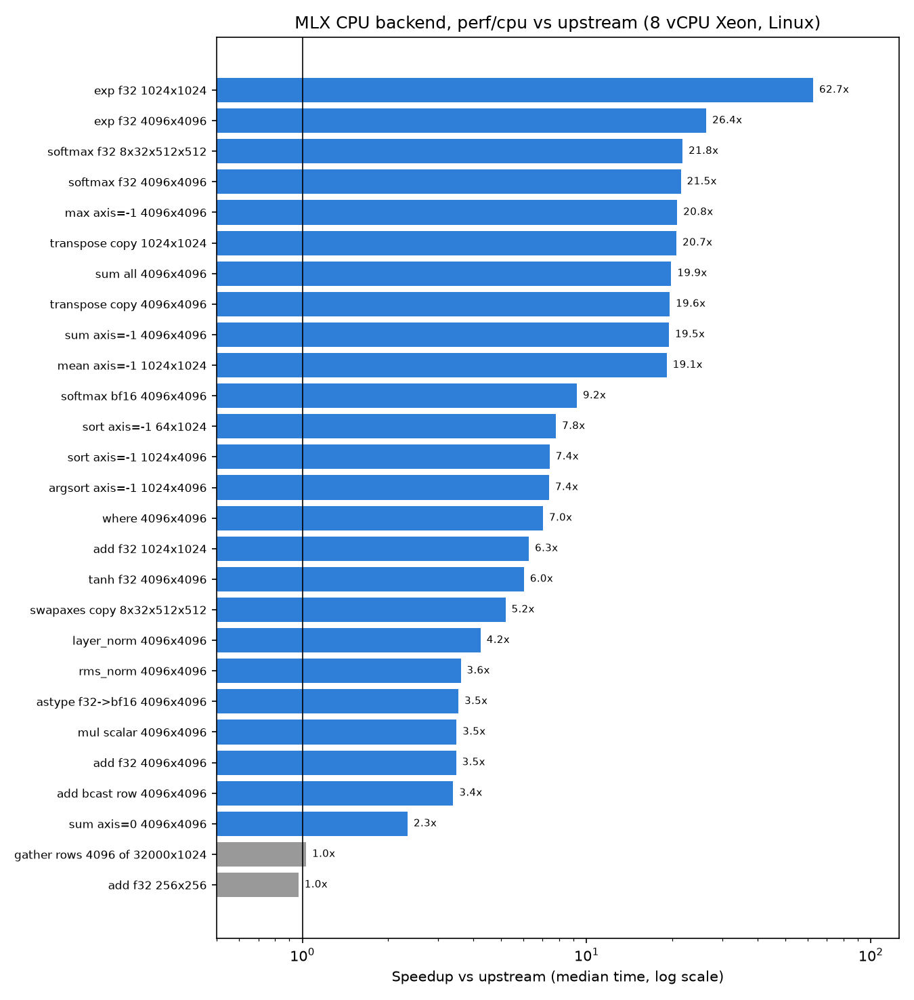

# CPU backend performance (`perf/cpu` branch)

This branch speeds up the hot paths of MLX's **CPU backend** on Linux/x86.
All numbers below were measured on the machine described here, with the
upstream commit `96fbf67` ("Slightly clean up code") as the baseline and the
tip of `perf/cpu` as the result. Nothing here is projected or estimated.

## Hardware and build

- CPU: Intel Xeon (8 vCPU, 1 thread per core, AVX2/AVX-512 capable),
  L2 16 MiB total, **L3 320 MiB**, 1 NUMA node, 16 GB RAM, Linux VM, no GPU.
- Compiler: GCC 13 (conda-forge), `-O3`, default x86-64 target (no
  `-march=native`), OpenBLAS.
- Build: `MLX_BUILD_METAL=OFF MLX_BUILD_CUDA=OFF`, Release, shared library,
  Python 3.12 bindings. Baseline and branch built with identical flags.

## Method

`benchmarks/python/cpu_ops_bench.py`: each op runs 5 warmup evaluations,
then 15 rounds of 10 `mx.eval` calls. The table shows the median per-call
time across rounds, with `[min..max]` of the per-round means. Inputs are
fixed-seed and reused between iterations.

The baseline was benchmarked twice (before and after the branch run) to
gauge run-to-run variation; "Before" is the second run. Memory-bound
single-threaded ops varied by up to ~15% between the two baseline runs
(e.g. `sum axis=0`: 3.21 ms vs 2.80 ms), so differences smaller than that
are noise. Raw JSON for all four runs is in `benchmarks/results/cpu_perf/`.

"1 thread" is the branch with `MLX_CPU_NUM_THREADS=1`; it isolates the
single-threaded changes (vectorized math, multiple accumulators, tiled
transposes) from the multithreading.

## Results

| Op | Before (ms) | After (ms) | Speedup | After, 1 thread (ms) | Speedup, 1 thread |
|---|---:|---:|---:|---:|---:|
| add f32 256x256 | 0.022 [0.021..0.024] | 0.022 [0.017..0.026] | 0.97x | 0.021 | 1.02x |
| add f32 1024x1024 | 0.435 [0.406..0.516] | 0.069 [0.066..0.086] | 6.27x | 0.406 | 1.07x |
| add f32 4096x4096 | 25.484 [23.180..31.519] | 7.334 [7.090..7.919] | 3.47x | 25.850 | 0.99x |
| add bcast row 4096x4096 | 22.567 [20.863..25.686] | 6.647 [6.260..8.256] | 3.40x | 21.135 | 1.07x |
| mul scalar 4096x4096 | 23.012 [21.424..26.190] | 6.600 [6.339..7.055] | 3.49x | 24.941 | 0.92x |
| exp f32 1024x1024 | 14.439 [14.322..15.723] | 0.230 [0.215..0.291] | 62.69x | 1.787 | 8.08x |
| exp f32 4096x4096 | 258.690 [257.333..268.583] | 9.809 [9.261..10.244] | 26.37x | 46.580 | 5.55x |
| tanh f32 4096x4096 | 96.783 [90.397..108.089] | 16.071 [14.995..20.044] | 6.02x | 95.569 | 1.01x |
| where 4096x4096 | 111.500 [107.919..115.901] | 15.860 [14.982..18.343] | 7.03x | 93.911 | 1.19x |
| astype f32->bf16 4096x4096 | 14.408 [14.020..16.039] | 4.068 [3.886..4.368] | 3.54x | 14.211 | 1.01x |
| sum all 4096x4096 | 8.742 [8.684..8.794] | 0.440 [0.403..0.773] | 19.85x | 2.953 | 2.96x |
| sum axis=-1 4096x4096 | 8.589 [8.490..8.787] | 0.441 [0.403..0.742] | 19.49x | 2.971 | 2.89x |
| sum axis=0 4096x4096 | 2.801 [2.719..2.879] | 1.194 [1.137..1.358] | 2.35x | 3.184 | 0.88x |
| max axis=-1 4096x4096 | 17.131 [16.978..17.725] | 0.822 [0.788..1.268] | 20.85x | 6.259 | 2.74x |
| mean axis=-1 1024x1024 | 0.575 [0.536..0.700] | 0.030 [0.028..0.037] | 19.14x | 0.142 | 4.04x |
| softmax f32 4096x4096 | 277.828 [274.587..290.573] | 12.943 [12.126..15.236] | 21.46x | 69.205 | 4.01x |
| softmax f32 8x32x512x512 | 1093.903 [1073.123..1122.113] | 50.256 [47.086..57.191] | 21.77x | 311.466 | 3.51x |
| softmax bf16 4096x4096 | 269.483 [264.649..274.855] | 29.155 [26.483..32.835] | 9.24x | 195.399 | 1.38x |
| rms_norm 4096x4096 | 59.788 [53.374..70.704] | 16.572 [15.604..17.735] | 3.61x | 48.056 | 1.24x |
| layer_norm 4096x4096 | 109.271 [93.028..126.127] | 25.787 [24.436..29.714] | 4.24x | 98.873 | 1.11x |
| transpose copy 4096x4096 | 184.504 [171.113..192.654] | 9.408 [7.959..14.866] | 19.61x | 44.146 | 4.18x |
| transpose copy 1024x1024 | 3.935 [3.829..3.997] | 0.190 [0.168..0.278] | 20.72x | 1.083 | 3.63x |
| swapaxes copy 8x32x512x512 | 170.868 [166.652..183.037] | 32.965 [30.773..39.068] | 5.18x | 190.604 | 0.90x |
| gather rows 4096 of 32000x1024 | 1.282 [1.195..1.346] | 1.243 [1.186..1.330] | 1.03x | 1.235 | 1.04x |
| sort axis=-1 1024x4096 | 204.777 [203.778..210.132] | 27.629 [27.058..30.854] | 7.41x | 208.003 | 0.98x |
| argsort axis=-1 1024x4096 | 245.353 [242.868..251.167] | 33.239 [31.521..38.028] | 7.38x | 244.989 | 1.00x |
| sort axis=-1 64x1024 | 2.808 [2.691..2.881] | 0.360 [0.347..0.491] | 7.81x | 2.858 | 0.98x |



Reading the table:

- **Every changed op is faster by more than the noise.** The two rows at
  ~1.0x are expected: `gather` was not changed, and `add f32 256x256`
  (256 KB) stays below the parallelization threshold on purpose.
- Single-threaded, nothing got slower beyond run-to-run noise (the 0.88x to
  0.92x rows are inside the spread of the two baseline runs).
- `exp` and `softmax` gain the most because the polynomial `exp` was not
  vectorized at all with GCC on x86 (see commit `c312552`), and then
  parallelism multiplies that.
- Arrays of 64 MB fit in this machine's 320 MiB L3, so the memory-bound
  results (add, copies, sums) are higher than you would see on a machine
  with a small cache or less memory bandwidth.

## Changes (one commit each)

| Commit | Change | Ops it affects |
|---|---|---|
| `1ff67f3` | Fork-join worker pool + `parallel_for` (generation-tagged tickets, nested/concurrent regions run serially, short spin before sleeping, `MLX_CPU_NUM_THREADS`) | infrastructure |
| `1e6f08a` | Split unary ops across threads; keep the inner loop out of line so GCC vectorizes it | exp, tanh, abs, ... |
| `7b742b9` | Split binary ops (contiguous and broadcast) across threads | add, mul, comparisons, ... |
| `81f05c1` | Split ternary ops across threads | where |
| `71fff91` | 32x32 tiled transpose-like copies; split copies/fills across threads | contiguous(), transposes, astype, slice update |
| `c312552` | Make the simd math approximations vectorizable with GCC on x86: multiply-add instead of libm `std::fma` without FMA, exact branch-free float `floor`, and `-fno-trapping-math` on GCC (clang's default; results unchanged) | exp, softmax, sigmoid, sin/cos, erf, ... |
| `47667fe` | 8 independent accumulators in contiguous reductions when there's no SIMD type (also more accurate) | sum, max, min, mean, prod, all/any |
| `4994380` | Split reductions across threads (all-reduce, rows, strided blocks/columns) | sum, max, mean, ... |
| `eb2a1db` | Split softmax rows across threads | softmax |
| `25766a1` | Sort/argsort rows in parallel | sort, argsort |
| `fe0fa8e` | Targeted tests vs NumPy and the benchmark script | |

`rms_norm` and `layer_norm` use the composed fallback on CPU, so they speed
up through the elementwise and reduction changes.

## Correctness

| Suite | Upstream `96fbf67` | `perf/cpu` |
|---|---|---|
| C++ `tests` (doctest, each case run separately) | 225 / 243 pass | 225 / 243 pass (same 18 failures) |
| Python `python/tests` | 775 run: 8 failures, 1 error, 60 skipped | 786 run (775 + 11 new): the same 8 failures and 1 error, 60 skipped |
| New `python/tests/test_cpu_parallel.py` | 10 / 11 pass (fails the float32 sum accuracy check) | 11 / 11 pass |

The failures shared by both builds are the `mx.compile` tests (all 18 in
C++ and 8 of the 9 in Python) plus `test_vmap.test_broadcast_axes_vmap`.
They fail the same way on upstream in this environment and are unrelated to
these changes.

The new tests compare against NumPy at sizes that cross the chunking
thresholds (ragged chunks, broadcasting, strided/transposed inputs,
special values for `exp` and `floor`, NaN handling, stable argsort). They
also check that outputs with `MLX_CPU_NUM_THREADS=1` and `4` are bit-identical
and that two CPU streams can run parallel kernels at once.

Numerics:

- `exp`: max relative error over [-87, 87] is 3.85e-6 on both builds (the
  approximation is unchanged).
- Float sums are more accurate. For a 16M-element float32 sum, the max
  relative error vs float64 goes from 1.1e-4 (upstream) to 8.5e-7.
- Sums and products are reassociated, so float results can differ from
  upstream in the last bits, and an all-reduce result depends on the thread
  count.

## Reproduce

```bash
# build (CPU only), from the repo root
mkdir build && cd build
cmake .. -G Ninja -DCMAKE_BUILD_TYPE=Release -DMLX_BUILD_METAL=OFF \
  -DMLX_BUILD_CUDA=OFF -DMLX_BUILD_PYTHON_BINDINGS=ON -DMLX_BUILD_TESTS=ON \
  -DBUILD_SHARED_LIBS=ON -DMLX_PYTHON_BINDINGS_OUTPUT_DIRECTORY=$PWD/../python/mlx
ninja -j4
cd ..
export PYTHONPATH=$PWD/python LD_LIBRARY_PATH=$PWD/build

python benchmarks/python/cpu_ops_bench.py --json after.json
MLX_CPU_NUM_THREADS=1 python benchmarks/python/cpu_ops_bench.py --json after_1t.json
# same command on a build of upstream 96fbf67 -> before.json, then:
python benchmarks/python/cpu_ops_report.py before.json after.json \
  --one-thread after_1t.json --chart speedup.png

python -m unittest discover python/tests
```

## Limits

- **CPU only, Linux x86 only.** No Metal or CUDA numbers. Apple Silicon was
  not built or tested: the thread pool and parallel kernels also run there,
  but their effect next to Accelerate/NEON SIMD is unmeasured, and so is the
  thread-count default on mixed performance/efficiency cores. The
  `-fno-trapping-math` and `fma`/`floor` changes apply only to GCC / x86
  builds without FMA/SSE4.1 at compile time.
- `mx.compile` fused CPU kernels (JIT) don't work in this environment on
  upstream either, so compiled graphs were not benchmarked. Fused kernels
  don't go through the elementwise paths changed here.
- One machine (an 8 vCPU VM with a very large L3). Memory-bound speedups
  depend on cache size and memory bandwidth.
- Small arrays (below about 128 KB per thread) stay single-threaded. The
  grain is a fixed constant, not tuned per op, so cheap-to-compute ops get
  less benefit at mid sizes than they could.
- Intermediate commits were not built one at a time; the full branch was
  built and tested.
- Not touched: BLAS/matmul, conv, gather/scatter, scans, quantized ops.
